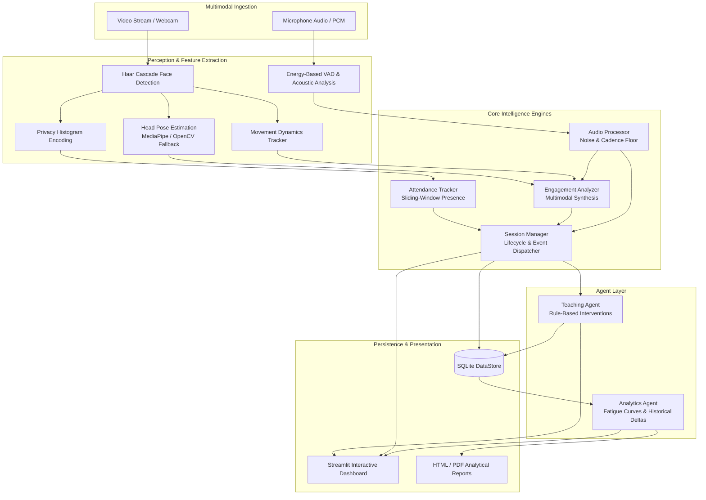

# Multimodal Attendance & Engagement Intelligence System

A production-ready, privacy-preserving classroom intelligence platform that seamlessly automates attendance tracking, quantifies student engagement through multimodal computer vision and acoustic behavioral cues, delivers real-time AI-driven pedagogical recommendations, and compiles deep post-session analytics.

---

## 🌟 Key Highlights

- **Privacy-Preserving Vision**: No raw face images are ever stored. Facial features are transformed into compact, non-reconstructible mathematical histogram embeddings.
- **Multimodal Behavioral Telemetry**: Simultaneously monitors head pose orientation, physical movement dynamics, micro-inactivity, and acoustic speech patterns.
- **Zero Cloud / LLM Dependencies**: Completely local, rule-based pedagogical intervention engine that responds in sub-second latency with zero API tokens or external server calls.
- **Dual Head-Pose Estimation Engine**: Integrates MediaPipe FaceMesh for high-accuracy landmark orientation, backed by a robust OpenCV geometric and eye-distribution fallback.
- **Sustained Presence Attendance**: Requires multi-frame temporal confirmation before marking attendance, filtering out transient passing individuals.
- **Interactive Dashboard & Automated Reports**: Features a responsive 2-column Streamlit dashboard and generates standalone HTML & PDF reports with embedded base64 performance charts.

---

## 📐 System Architecture



---

## 📁 Repository Structure

```
project 1/
├── README.md                     # Comprehensive project documentation
├── requirements.txt              # Production dependency specifications
├── config.py                     # Dataclass configuration system
├── main.py                       # Click-powered CLI entrypoint
├── run_demo.py                   # Standalone offline simulation demo (no camera/mic required)
├── core/
│   ├── __init__.py
│   ├── attendance_tracker.py     # Sliding-window sustained attendance engine
│   ├── engagement_analyzer.py    # Per-student & class engagement computation
│   ├── audio_processor.py        # Voice activity detection (VAD) & acoustic levels
│   └── session_manager.py        # Lifecycle coordinator & event dispatcher
├── agents/
│   ├── __init__.py
│   ├── teaching_agent.py         # Rule-based real-time pedagogical assistant
│   └── analytics_agent.py        # Post-session KPI & fatigue curve evaluation
├── ui/
│   ├── __init__.py
│   ├── dashboard.py              # Interactive Streamlit 2-column live dashboard
│   └── report_generator.py       # Standalone HTML and PDF report generator
├── utils/
│   ├── __init__.py
│   ├── face_utils.py             # Haar cascades, histogram embeddings & pose estimation
│   ├── data_store.py             # SQLite thread-safe persistence layer
│   └── logger.py                 # Rich console & JSON Lines session logger
├── data/
│   ├── sessions/                 # SQLite database & session exports
│   ├── reports/                  # Generated HTML & PDF pedagogical reports
│   └── logs/                     # Timestamped JSON Lines diagnostic logs
└── tests/
    ├── __init__.py
    ├── test_attendance.py        # Sustained presence, absence timeout, and log tests
    ├── test_engagement.py        # Score boundary, pose, and movement tests
    └── test_agents.py            # Teaching agent rules, priorities, and cooldowns
```

---

## 🚀 Quick Start Guide

### 1. Prerequisites & Environment Setup

Python 3.9+ is recommended. Create and activate a clean virtual environment:

```bash
# Windows
python -m venv venv
venv\Scripts\activate

# Linux / macOS
python3 -m venv venv
source venv/bin/activate
```

Install the dependencies:

```bash
pip install -r requirements.txt
```

---

### 2. Run the Offline Simulation Demo (Primary Verification)

To verify the entire pipeline without hardware cameras or microphones, run `run_demo.py`:

```bash
python run_demo.py
```

Or through the CLI:

```bash
python main.py demo
```

**What this does:**
1. Generates synthetic classroom video frames with 5 distinct student behavioral archetypes (High Engagement, Note-Taker, Fatigue Drop, Restless/Distracted, and Late Arrival).
2. Simulates acoustic questions and ambient background chatter.
3. Automatically executes the complete perception, tracking, engagement, and teaching agent loops.
4. Generates a standalone HTML report saved to `data/reports/`.
5. Renders a terminal dashboard with Rich tables, KPI summaries, and recommendations.

---

### 3. Launch the Interactive Streamlit Dashboard

Run the real-time web dashboard:

```bash
streamlit run ui/dashboard.py
```

The browser will open to `http://localhost:8501`, featuring:
- **Live Video Feed**: Annotated bounding boxes color-coded by real-time engagement.
- **Verified Attendance Panel**: Live roster with status badges (Present, Late, Absent).
- **Engagement Radial Gauge**: Real-time 0–100% dial with critical warning thresholds.
- **Plotly Progression Chart**: Interactive time-series line graph tracking class focus.
- **Acoustic Activity Indicator**: Live audio RMS level and speech detection status.
- **AI Teaching Suggestions Panel**: Color-coded cards providing timely interventions.

---

### 4. Command Line Interface (CLI) Commands

The system provides a Click CLI via `main.py`:

#### Start Live Classroom Monitoring
```bash
python main.py start --subject "Computer Science" --instructor "Prof. Turing" --camera 0
```
*Add `-d` to automatically launch the Streamlit dashboard in parallel.*

#### List Historical Sessions
```bash
python main.py list-sessions
```

#### Generate Post-Session Analytical Report
```bash
python main.py report --session-id <SESSION_ID>
```

---

## 🧠 Core Intelligence & Rule Engine

The `TeachingAgent` monitors ongoing telemetry and triggers prioritized interventions:

| Category | Priority | Trigger Condition | Recommended Pedagogical Action |
| :--- | :--- | :--- | :--- |
| **BREAK** | `HIGH` | Session $>45$ min with declining focus | Attention fatigue detected; take a 5-minute break or physical stretch. |
| **PACING** | `URGENT` | Sudden engagement drop ($<-1.2\%$/sec) | Pacing may be too fast or too slow; pause for a quick comprehension check. |
| **MANAGEMENT** | `MEDIUM` | High noise ($>50\%$) + low visual engagement ($<45\%$) | Side chatter detected; redirect attention with a focused cold-call question. |
| **INTERACTION** | `HIGH` | Sustained class engagement $<40\%$ | Attention is low; initiate a live poll, interactive exercise, or think-pair-share. |
| **CONTENT** | `LOW` | Sustained focus $>80\%$ with rising trend | Class focus is optimal; prime window to present complex or core concepts. |

---

## 🔒 Privacy & Security Standards

1. **No Raw Image Storage**: The system extracts a 256-dimensional spatial histogram descriptor. Raw pixels and facial photographs are never saved to disk or transmitted over networks.
2. **Local Processing**: All computer vision, speech activity detection, and rule evaluation occurs entirely on the local machine.
3. **Structured Audit Logs**: Every session produces timestamped JSON Lines logs recording metrics for transparency and auditing.

---

## 🧪 Running the Test Suite

Execute the unit test suite across attendance tracking, behavioral engagement, and pedagogical agent rules:

```bash
# Run with pytest
pytest tests/ -v

# Or run with standard unittest
python -m unittest discover tests
```

### Test Coverage Highlights:
- `test_attendance.py`: Validates manual marking, sustained presence requirement ($N$ frames), absence timeouts, and log schema consistency.
- `test_engagement.py`: Validates bounded outputs $[0.0, 1.0]$, head pose penalties, movement curve dynamics, and linear trend regression.
- `test_agents.py`: Validates low-engagement alerts, positive reinforcement prompts, priority level mappings, and cooldown suppression.

---

## 📄 License
This project is released under the MIT License.
